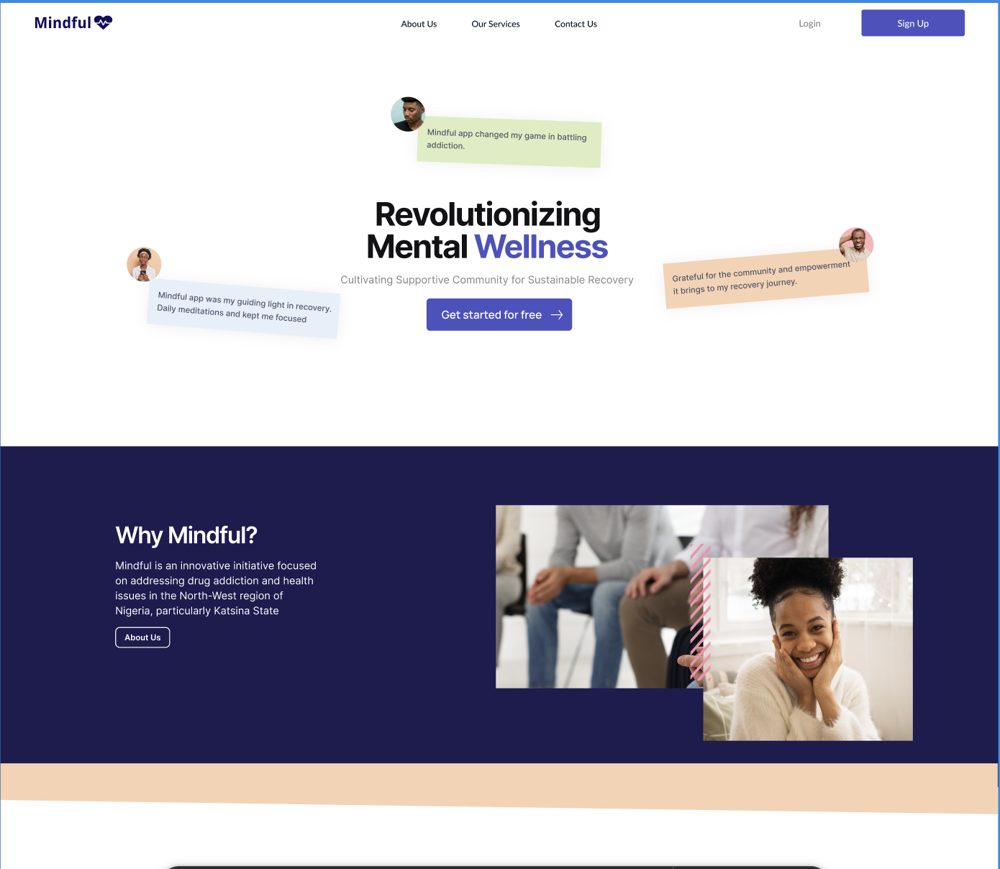
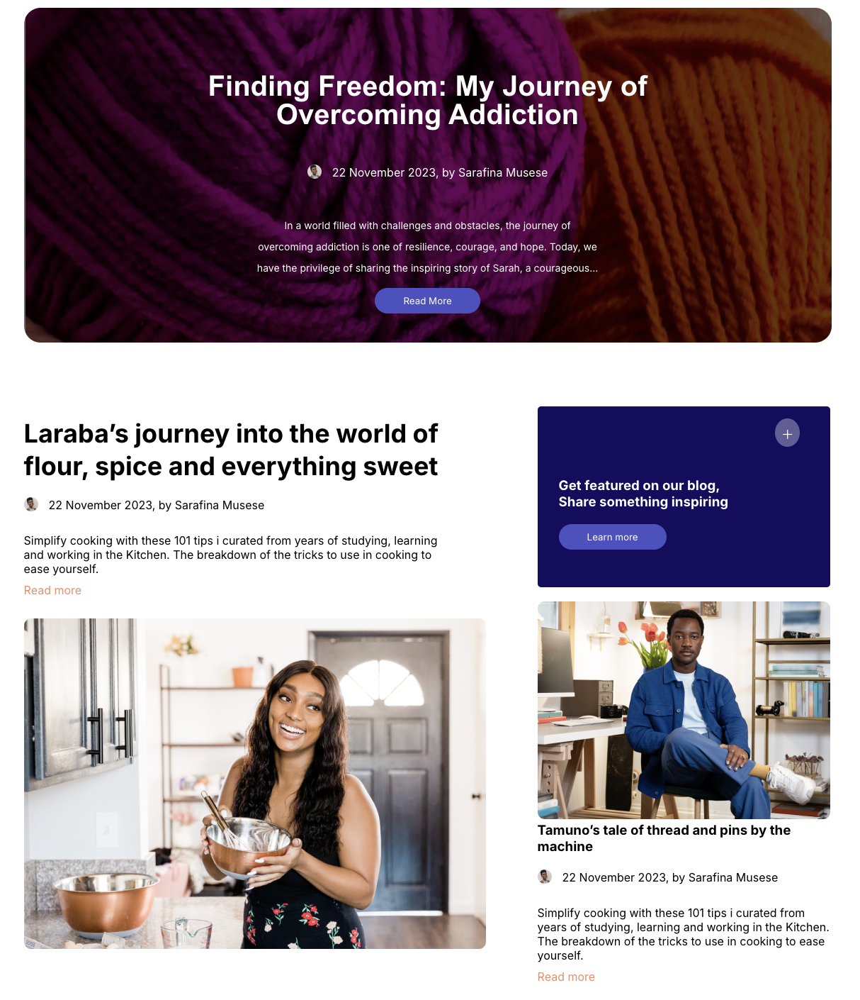
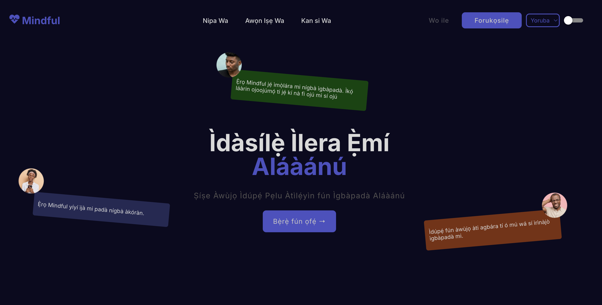
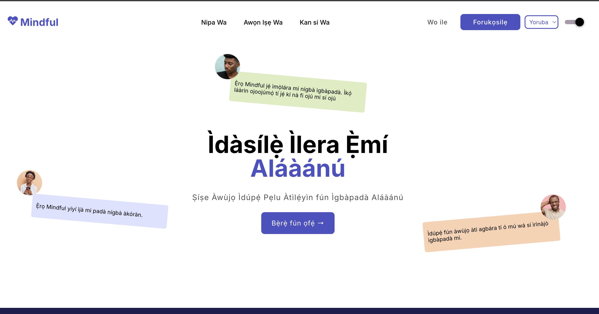

# Mindful — Mental Wellness Web App (Capstone Project)

A frontend-focused mental wellness web application built as a **capstone project** for the **Tech4Dev Women Techsters Fellowship**.

🌐 **Live App:** https://mindful-app.vercel.app/

---

## Overview

Mindful is a web application designed to promote mental wellness through a calm, accessible, and inclusive user experience.

The application focuses primarily on **frontend functionality**, with **Firebase Authentication** used for user sign-in. It supports **multiple Nigerian languages** and includes **light and dark theme** switching to improve accessibility and comfort.

---

## What This Project Demonstrates

- Frontend-focused application development
- User authentication using Firebase
- Multi-language (i18n) support
- Light and dark theme implementation
- Component-based architecture in a real project
- Building for accessibility and inclusivity

---

## Key Features

- 🔐 User authentication with Firebase
- 🌍 Multi-language support:
  - English
  - Hausa
  - Igbo
  - Yoruba
- 🌗 Light and dark theme toggle
- 📱 Responsive design across devices

---

## Tech Stack

- **React.js**
- **JavaScript**
- **CSS**
- **Firebase Authentication**
- **Vercel** (deployment)

---

## Screenshots

> Screenshots are stored in `/public/screenshots/`






---

## Local Development

To run this project locally:

```bash
git clone https://github.com/graycepaul/mindful-app.git
cd mindful-app
npm install
npm run start
```
